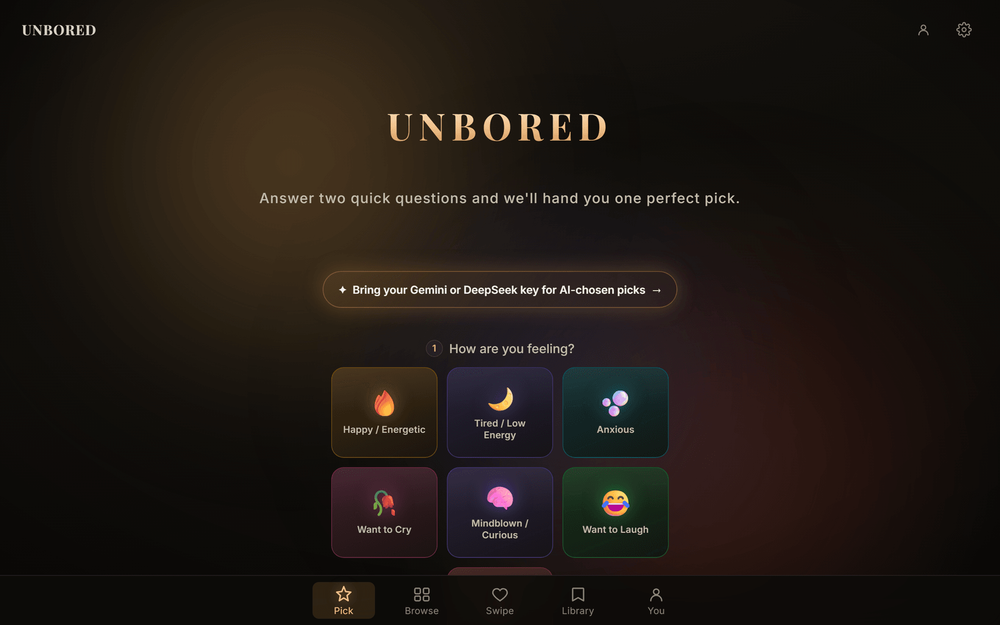
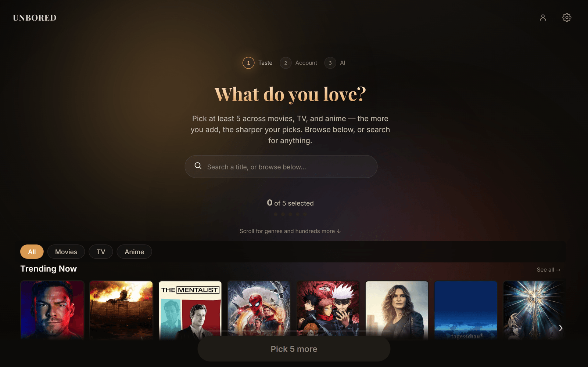
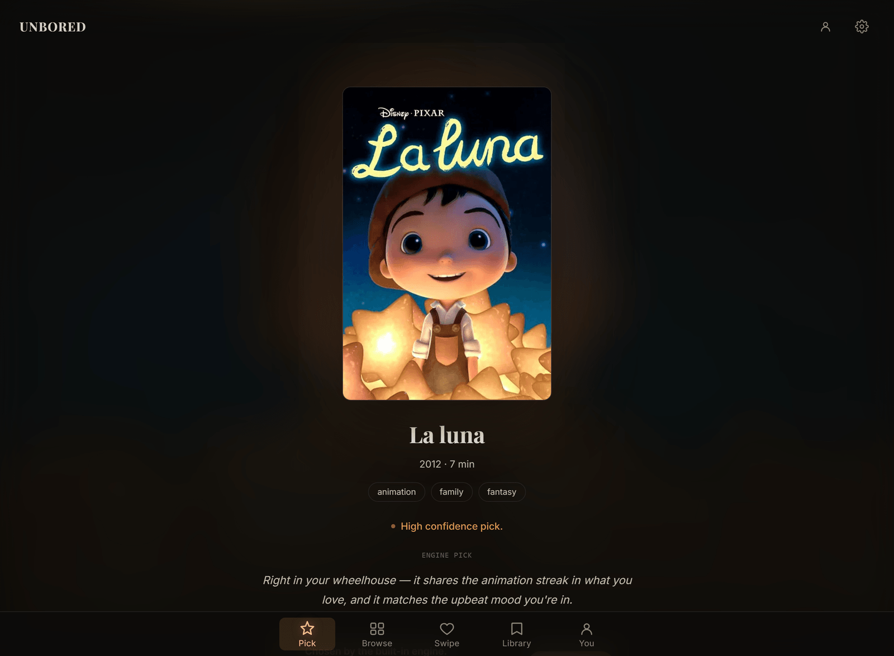
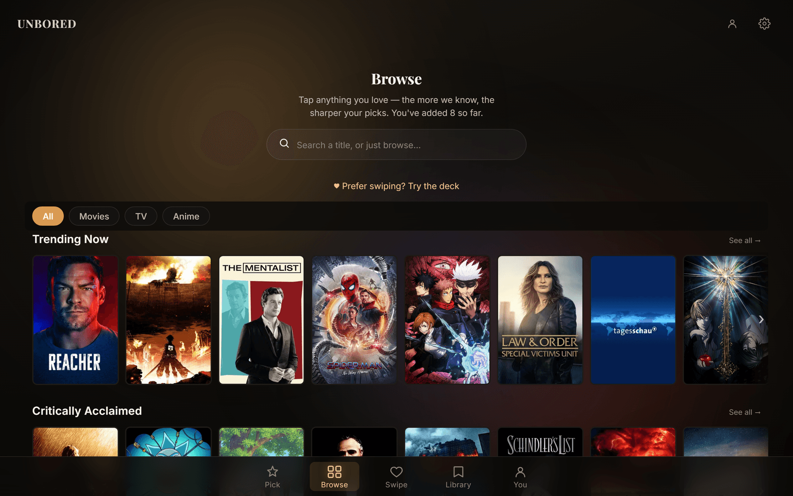
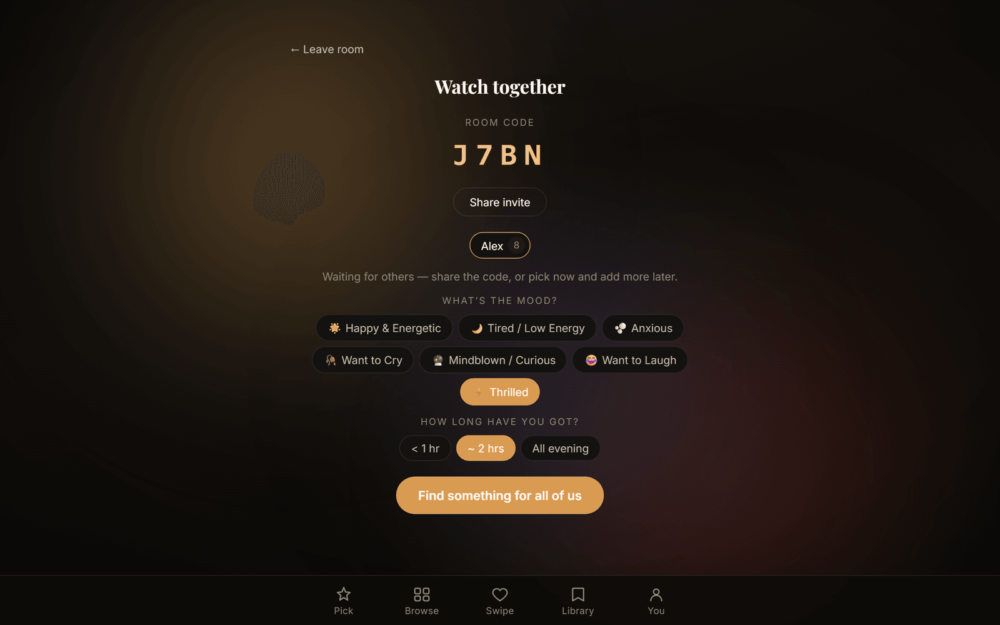
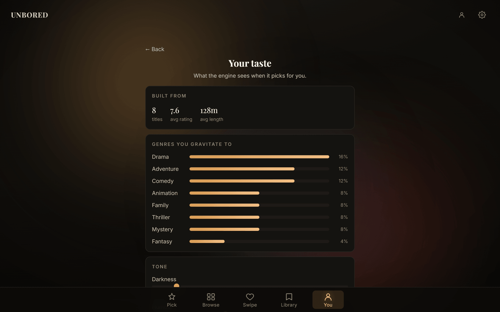

# Unbored

**Tell us a few things you love. Get one perfect pick — chosen and explained by AI.**
No infinite scroll, no twenty-minute "what should we watch" negotiation.


### ▶ [Live demo → unbored-five.vercel.app](https://unbored-five.vercel.app)

Opens instantly: the recommender runs in your browser, so there's no server to wake up. AI picks
work without a key on a shared free tier (a few a day); bring your own Gemini or DeepSeek key for
unlimited.



---

## Why this exists

The problem isn't a shortage of things to watch — it's the opposite. Endless catalogs, endless
scrolling, and a nightly negotiation that ends with the phone back in your pocket. Unbored replaces
all of that with **one pick you can trust**: found by a real content-based engine, then chosen and
explained by an LLM grounded in the exact things you said you love.

---

## How it works

**1. Tell it what you love.** A short, browse-first onboarding — search or scroll and tap a handful
of favourites across movies, TV, and anime. Or import your Letterboxd or IMDb ratings.

**2. A real engine narrows the field, on your device.** Every title is both a **dense semantic
embedding** (it understands *meaning* — "a film about grief" matches "a story of loss" with zero
shared words) **and** a BM25 sparse vector (it nails exact title / keyword / cast matches). Your taste
is the centroid of, and nearest neighbours among, the things you picked. The engine ranks the whole
catalog by this hybrid similarity, then re-ranks the top matches by your mood and the time you have.
It runs in a Web Worker in your browser and is genuinely good *on its own* — no LLM required.

**3. AI makes the final call.** The LLM picks the single best option from the engine's shortlist and
explains it in one sentence, tied to what you love. If it's slow or out of free picks, the engine's
pick stands and the app says so.

```text
 You pick favourites ─▶ Engine (in your browser) ─▶ shortlist ─▶ AI ─────────▶ one pick
 (or import ratings)    BM25 · kNN+centroid                     (free tier     + a reason
                        tone · runtime · MMR                     or your key)   in your words
```

<p align="center">
  
  
</p>

---

## What's inside

Everything below is built by hand — no UI kit, no component library, no chart library.

- **Pick** — mood + time in, one confident pick out, with a cinematic reveal and alternates. The
  reveal shows **where to watch it in India** (subscription, rent and buy, from JustWatch via TMDB),
  a **click-to-load trailer**, and a **share card** you can send as an image.
- **Why not X?** — name any title you expected instead and see how it scored against your pick,
  signal by signal, under the same request.
- **Browse** — shelf rows over the whole catalog, including **New This Week** after each weekly
  refresh. Genre rows rank by how well a title *fits* the genre, and every title appears in one row.
- **Swipe** — a card deck to build taste fast: fling right to keep, left to pass, with undo.
- **Watch Together** — start a room, share a four-character code, and everyone joins with the taste
  their browser already holds. The group gets **one blended pick**, or runs **veto rounds**: five
  titles, everyone strikes one per round, the best survivor wins. Rooms survive refreshes and
  redeploys.
- **Import ratings** — Letterboxd or IMDb CSV, read in the browser and never uploaded. A preview
  shows what matched before anything is saved.
- **Fine-tune** — four sliders (familiar ↔ adventurous, crowd-pleasers ↔ hidden gems,
  anything ↔ acclaimed, timeless ↔ fresh). Zero on every axis is an exact no-op.
- **Library** — a watchlist, plus *seen* and *not for me* so nothing is suggested twice.
- **Your taste** — what the engine sees: genres, tone profile, eras, recurring names.
- **Accounts (optional)** — sign in to sync taste, library and settings across devices. Nothing is
  gated behind an account.
- **Picks work offline** after your first visit (installable PWA): the catalog and engine are cached
  on the device.

<p align="center">
  
  
</p>
<p align="center">
  
  
</p>

---

## The engine

The engine is the centrepiece. It's written in Python as the reference implementation and ported
line for line to TypeScript, which is what runs in the browser.

- **Hybrid dense + sparse retrieval.** A dense embedding (`bge-small-en-v1.5`, 384 dims, computed at
  build time) captures meaning; a BM25-weighted sparse vector over title, genres, keywords, overview
  and people captures exact matches. The browser builds the BM25 index from the catalog text when it
  loads, so it costs no download.
- **kNN + centroid relevance** with a similarity-weighted neighbour mean, so loving *both* horror and
  rom-coms doesn't average into mush.
- **Tone model** — five interpretable axes (energy, darkness, warmth, intensity, humor) give a smooth
  mood fit instead of genre on/off toggles.
- **Retrieve-then-rerank** — the strongest 120 taste matches, re-ranked by mood and runtime, so the
  mood you pick actually changes the result.
- **Bayesian quality prior**, **smooth runtime fit**, **MMR-diversified alternates**, and
  **distribution-calibrated confidence**.

**Keeping the two engines honest.** The Python engine generates fixtures — 320 seeded requests across
every mood, time slot, era, media type, profile size and tuning setting, plus search and taste cases —
and the TypeScript engine must reproduce every pick, alternate, confidence and top-20 score (to 1e-4).
CI regenerates the fixtures and fails if they're stale.

**What it ships.** The data pack is 2,420 titles in **1.7 MB gzipped**: card text plus embeddings
stored as int8 with a scale per vector. Against full-precision vectors, int8 picks the same top title
for **95%** of 100 seeded taste profiles, with a mean top-10 overlap of **0.97**; most disagreements
are near-ties. The build fails if the pack goes over 3 MB.

---

## AI picks

| | Free tier | Your own key |
| --- | --- | --- |
| Model | Gemini (shared key) | Gemini or DeepSeek |
| Limit | 20 picks a day per visitor, with a site-wide daily cap | none |
| What the AI does | chooses from the shortlist and explains | also widens the search before the engine shortlists |

One compact call per pick sends your liked titles, mood and the shortlist — catalog titles only —
and gets back the pick and a one-line reason. The AI functions only accept catalog ids, so the shared
key can't be used for anything else. Visitors are counted by a salted hash of their IP; the IP itself
isn't stored. **Free-tier requests go to Google, which may use them to improve its models**; the app
says so where you'd choose.

With your own key ([Gemini](https://aistudio.google.com/app/apikey) is free to set up;
[DeepSeek](https://platform.deepseek.com/api_keys) is low-cost), the key stays in your browser's
session, is sent per request over HTTPS, and is never logged or stored.

---

## Privacy

- Taste, library and settings live in your browser unless you sign in.
- Imported rating files are read on your device and never uploaded.
- **Watch Together shares your favourite titles' ids with the other people in the room**, because each
  member's browser computes the group pick. The room shows only counts, but anyone in it could see the
  list. Rooms expire after 12 hours.
- Errors are reported to Sentry when configured, without request bodies or headers.

---

## Run it locally

```bash
python run.py
```

(Or `start.bat` / `./start.sh`.) Needs **Node.js 20+**; Python 3.11+ only for the engine tests and
catalog tools. No keys needed: the app runs on the bundled catalog, and the AI functions run inside
the Vite dev server. Put `GEMINI_API_KEY` in `frontend/.env` to try the free tier locally, and
Supabase settings to enable accounts and Watch Together (see `frontend/.env.example`).

---

## Architecture

```text
 Browser (Vercel, static)                              Vercel functions
 ┌──────────────────────────────────────────┐ shortlist ┌───────────────────────────────┐
 │ Data pack (content-hashed, cached):       │ ────────▶ │ /api/ai/curate  free or own key│
 │   cards · int8 embeddings · shelves       │           │ /api/ai/expand  own key only   │
 │ Engine in a Web Worker (TS port)          │ ◀──────── │ /api/ai/validate · quota       │
 │ Search · taste · browse · import, local   │  reason   │ /api/poster     share-card art │
 │ Rooms: Supabase Realtime presence+broadcast│          │ quota + reason cache ─▶ Supabase│
 └──────────────────────────────────────────┘           └───────────────────────────────┘

 Weekly (GitHub Actions): build_catalog → build_embeddings → build_web_pack
   → parity fixtures → pytest + parity suite → pull request
```

- **Catalog.** `backend/scripts/build_catalog.py` builds ~2,400 titles from TMDB (movies, TV) and
  AniList (anime), with India availability, trailers and IMDb ids. Each title keeps the date it first
  appeared. A weekly workflow rebuilds everything and opens a PR once the checks pass. (The catalog
  committed today predates availability and trailers; they arrive with the first refresh. Until then
  the reveal falls back to a web search for where to watch.)
- **Python's role.** The FastAPI app in `backend/` is the reference engine and the test oracle; it
  isn't deployed.
- **Supabase** holds optional accounts, the free-tier counters and reason cache (service role only),
  and Watch Together room codes (reachable only through two database functions).
- **Monitoring.** Per-route error boundaries, Sentry (optional), and an hourly uptime check that
  opens an issue if the site, the data pack or the AI health endpoint stops answering.

---

## Development

```bash
# Frontend (from frontend/)
npm run dev                       # http://localhost:5173, AI functions included
npm run lint && npm test          # 544 tests: engine parity, local API, rooms, AI functions, UI
npm run test:e2e                  # 16 Playwright runs (8 specs × desktop + mobile)
npm run build

# Backend (from backend/)
python -m pytest                  # 161 tests: engine, catalog, pack, quantization

# Rebuild data (needs TMDB_API_KEY in backend/.env)
python scripts/build_catalog.py
python scripts/build_embeddings.py   # pip install fastembed
python scripts/build_web_pack.py
python scripts/export_parity_fixtures.py
```

Deployment needs these Vercel environment variables: `GEMINI_API_KEY`, `SUPABASE_URL`,
`SUPABASE_SERVICE_ROLE_KEY`, `IP_HASH_SALT`, and optionally `SENTRY_DSN` / `VITE_SENTRY_DSN`. The
database migrations are in `supabase/migrations/`.

---

## Tech stack

**Frontend** — React 19, Vite, TypeScript, Zustand, Framer Motion, CSS Modules, Web Workers, an
installable PWA. No UI kit; the visual identity and every animation are hand-built.
**Functions** — Vercel (TypeScript), no SDKs.
**Engine reference + data tools** — Python, FastAPI, numpy, Pydantic v2.
**Data** — a self-owned catalog from TMDB (movies/TV, availability from JustWatch) and AniList (anime).
**Realtime + accounts** — Supabase.
**Testing** — pytest, Vitest, Playwright.

---

## License

MIT — see [LICENSE](LICENSE). Built by Shreyas Fegade. Catalog data from TMDB and AniList; streaming
availability from JustWatch via TMDB. This product uses the TMDB API but is not endorsed or certified
by TMDB.
